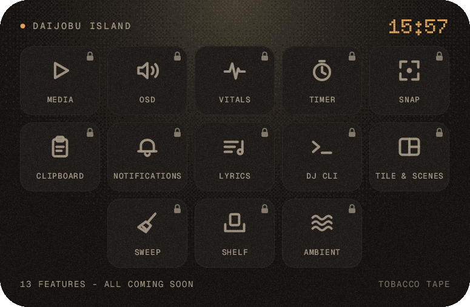
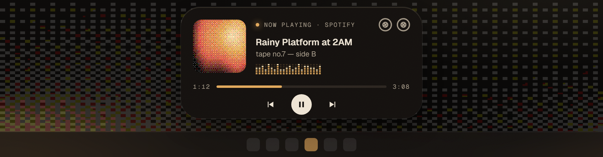
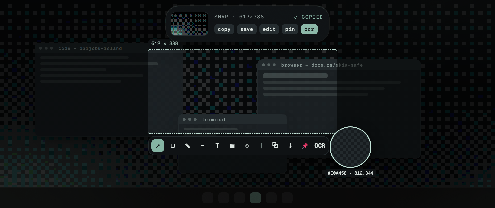
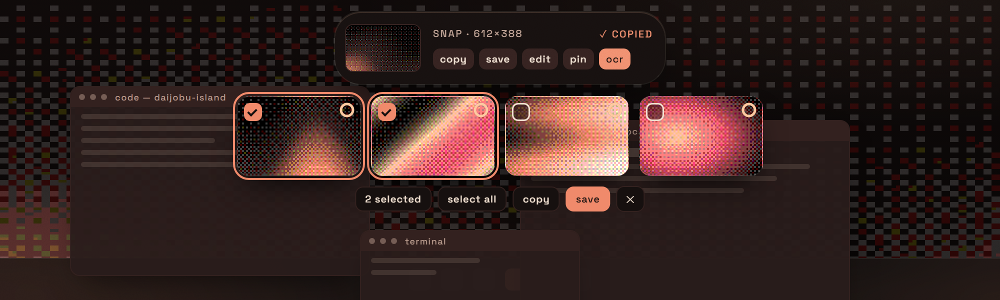
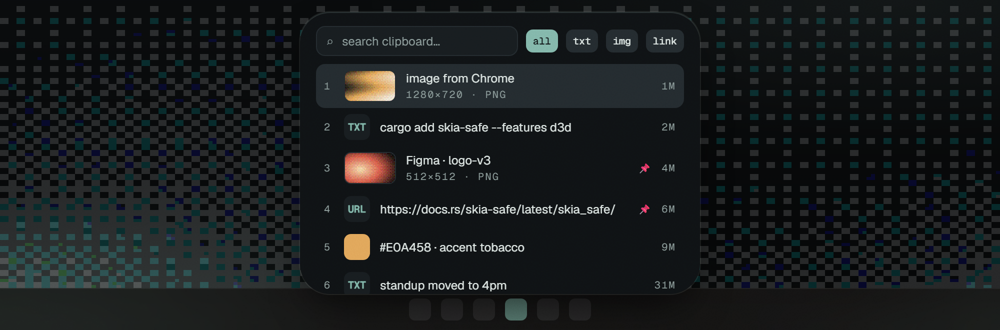
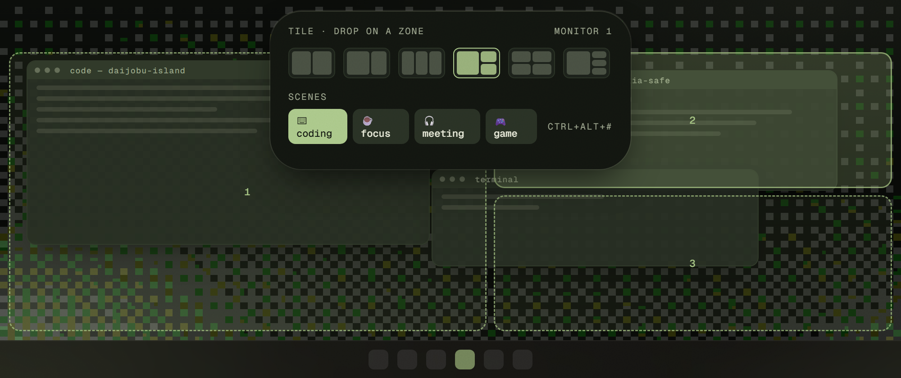
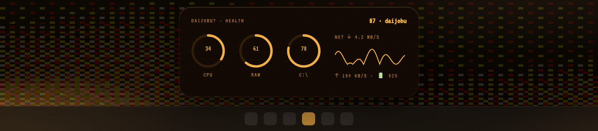
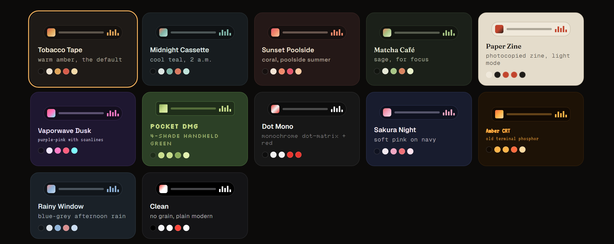

<h1 align="center">Daijobu Island</h1>

<p align="center">
  A lofi dynamic island for Windows 11.<br>
  Rust, Skia and plain Win32. WebView2 only for the YouTube Music engine.
</p>

<p align="center">
  <a href="LICENSE"></a>
  
  
  <a href="https://github.com/xDaijobu/daijobu-island/stargazers"></a>
</p>

<p align="center">
  <br><br>
  
</p>

<p align="center"><sub>The current build running on Windows 11. Every feature is still locked while it gets built.</sub></p>

---

*Daijobu* (大丈夫) is Japanese for "it's fine" or "are you okay?". The island sits at the top of the screen and stays out of the way. When you need it, it opens up to show what's playing, catch a screenshot, bring back something you copied, put your windows in place, or tell you whether your PC is having a bad day.

## Status

Early development. The app shell, Music (YouTube Music), the volume OSD, Vitals with Sweep, the Timer, Snap (capture, annotations, preview stack), window tiling and the `dj` CLI are in. Features get unlocked one at a time, each in its own stage. Day-to-day progress is tracked in [`task/progress.md`](task/progress.md).

| Stage | | |
|---|---|---|
| 1 | App shell: window, Skia renderer, spring motion, themes, tray | ✅ done |
| 2 | Music: YouTube Music playing headless, the island as the player | ✅ merged, testing |
| 2b | Music library: search, playlists, queue inside the island | locked |
| 3 | Volume OSD replacing the Windows flyout | ✅ merged, testing |
| 4 | Vitals: health score, CPU/RAM/disk/net rings | ✅ merged, testing |
| 5 | Vitals + Sweep: disk I/O, top processes, safe disk cleanup | ✅ done |
| 6 | Timer / pomodoro | ✅ done |
| 7a–7c | Screenshots: capture, annotate, floating preview stack | ✅ done |
| 8 | Clipboard history | locked |
| 9–10 | Notifications, lyrics | locked |
| 11 | `dj` CLI: live progress and messages from any script | 🟡 testing |
| 12a | Window tiling: zones, a layout picker in the island, a window picker | ✅ done |
| 12b–12d | Scenes, restore-after-reboot, admin apps | locked |
| 13 | File shelf, ambient sounds | locked |

## Where it's going

These are design mockups from [`docs/plan.html`](docs/plan.html), not screenshots. Open that file in a browser for the interactive version.

<table>
  <tr>
    <td width="50%"><br><b>Media.</b> Now playing from any app that reports to Windows, with a segmented VU visualizer.</td>
    <td width="50%"><br><b>Snap.</b> Region screenshots with a loupe, annotations, blur, OCR and pin-to-screen.</td>
  </tr>
  <tr>
    <td><br><b>Snap stack.</b> New screenshots float under the island for a few seconds. Select several and drag them straight into Discord, Explorer or a browser.</td>
    <td><br><b>Clipboard.</b> History for text, links, colours, files and images, in the spirit of <code>Win+V</code>.</td>
  </tr>
  <tr>
    <td><br><b>Tile & Scenes.</b> Split windows into zones. Save a layout and have it restored after a reboot, admin apps included, through a one-time Task Scheduler consent.</td>
    <td><br><b>Vitals.</b> CPU, memory, disk and network, plus a health score that answers the question in the name.</td>
  </tr>
</table>

### Themes

Themes are small TOML files. Each one sets more than colours: fonts, grain, dither, corner shape, visualizer style and how bouncy the motion is. Drop a file into `~/.daijobu/themes/` and the island picks it up live. `Ctrl+Alt+T` cycles through them.



Four of these ship with the current build (Tobacco Tape, Midnight Cassette, Paper Zine, Clean). The rest come later.

### dj CLI

Any script can put something on the island:

```sh
dj progress 40 deploy        # a progress bar, updated by each call
dj progress 80 deploy
dj done "build ok"           # a check mark for a few seconds
dj notify "tests failed"     # a short message (click it to dismiss)
dj theme paper-zine          # switch the theme; `dj theme` lists them
dj snap                      # start a screenshot
```

`dj.exe` is built next to `daijobu.exe` (`target/release/`); put that folder on your `PATH`. It talks to the island through a named pipe that only your user, in your session, can open, and no command runs programs or touches files. Exit codes: 0 ok, 1 error, 2 the island isn't running.

A few ways to use it:

```powershell
# a build that reports either way
cargo build --release; if ($?) { dj done "build ok" } else { dj notify "build failed" }

# any long command, with an open-ended progress while it runs
function Watch-Job([string]$Label, [scriptblock]$Job) {
    dj progress $Label
    & $Job
    if ($?) { dj done "$Label ok" } else { dj notify "$Label failed" }
}

# CI
gh run watch; dj done "CI finished"

# a coding agent's hook when it needs you
dj notify "the agent needs input"
```

## Building

Requirements: Windows 11, stable Rust (MSVC toolchain), Visual Studio Build Tools with the C++ workload, and Windows SDK 10.0.26100 or newer.

```sh
git clone https://github.com/xDaijobu/daijobu-island
cd daijobu-island
cargo build --release
target\release\daijobu.exe
```

`skia-safe` downloads a prebuilt Skia, so the first build takes well under a minute on top of the Rust compile.

| Shortcut | Action |
|---|---|
| Click the island | Expand / collapse |
| `Ctrl+Alt+H` | Hide / show |
| `Ctrl+Alt+T` | Next theme |

The tray icon has the same controls, plus *Start with Windows*. Settings live in `~/.daijobu/config.toml`.

By default the island is a notch attached to the top edge of the screen. To get the floating pill back, flip *Island style* in the Settings panel or set `[island] style = "pill"` in the config.

The notch also reserves a strip as tall as itself along the top of the screen, so maximized windows (and browser tabs) start below it instead of under it. Turn it off with *Reserve top space* in Settings, or `[island] reserve_top = false`.

## How it's built

- **Window:** a raw Win32 popup (`WS_EX_NOREDIRECTIONBITMAP`, tool window, topmost, never activates) with a DirectComposition visual. Clicks outside the pill fall through to whatever is underneath.
- **Rendering:** Skia's GPU backend on Direct3D 12, presenting through a premultiplied-alpha composition swap chain. Grain and dither are SkSL shaders.
- **Motion:** damped springs (stiffness and damping derived from response and damping ratio) that can be interrupted mid-flight.
- **Idle cost:** none. When nothing moves, the message loop blocks and nothing is drawn.
- **Music:** the only place a webview is used. YouTube Music runs in a hidden WebView2 (its window only shows for sign-in and browsing), and the island is its player. The engine starts only when you use Music; the island itself is still drawn with Skia.

```
app/              the daijobu binary
crates/dj-core    springs, themes, feature registry, island state (no unsafe, no Win32)
crates/dj-render  Skia + D3D12 + DirectComposition
crates/dj-win     window, tray, hotkeys, autostart, sound
crates/dj-music   YouTube Music engine (hidden WebView2)
crates/dj-vitals  CPU, RAM, disk, net, disk I/O, battery, top processes
crates/dj-sweep   disk cleanup: scanners, protected-path guard, recycle, operations log
```

More crates (capture, clipboard, tiling, …) are added as their stages start. [`AGENTS.md`](AGENTS.md) describes the conventions and the stage-by-stage workflow.

## Privacy

No telemetry. When the clipboard and screenshot features land, everything stays on your machine. Clipboard history will be encrypted with Windows DPAPI and will skip anything a password manager marks as private.

## Acknowledgements

The island-on-Windows idea owes a lot to [WinIsland](https://github.com/WinIslandProject/WinIsland), and the cleanup features take ideas from [Mole](https://github.com/tw93/Mole). Both are GPL-3.0. Daijobu Island is an independent project and shares no code with either. And of course Apple's Dynamic Island, which started it all.

## Contributing

Issues and ideas are welcome. The project is built in stages (see [`task/progress.md`](task/progress.md)), so it helps to check which stage a feature belongs to before opening a PR. Conventions are in [`AGENTS.md`](AGENTS.md).

## Thanks

To everyone who tries an early build, files an issue, or just reads this far: thank you. If Daijobu Island looks useful, a ⭐ on the repo helps other Windows users find it.

<a href="https://star-history.com/#xDaijobu/daijobu-island&Date">
  
</a>

## License

Licensed under the [Apache License, Version 2.0](LICENSE). See [`NOTICE`](NOTICE) for bundled fonts (SIL Open Font License 1.1).

Unless you explicitly state otherwise, any contribution you intentionally submit for inclusion in this project is licensed under Apache-2.0 as above, without any additional terms or conditions.
